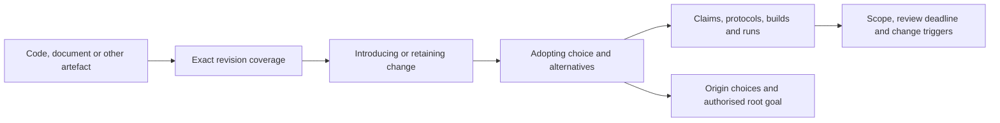

# How Verifiable Practice Works

Verifiable Practice (VP) is a **full project quality management system for human–AI collaboration**. It combines project governance and planning, evidence-based technical work, durable decision/artefact records, independent assurance, controlled acceptance and continuing revalidation.

The system covers a project from its originating goal to maintenance, recovery and retirement. Code, specifications, documents and experiments use the same management and traceability principles. Falsifiability and honest reporting are its epistemic foundation; roles, controls and records make those principles operational across sessions and contributors.

## What the System Manages

| Quality function | Required project work | Where VP defines it |
|------------------|-----------------------|---------------------|
| Planning | Goal and mandate, scope, requirements, acceptance/harm criteria, responsibilities, risks, stages, budgets and tolerances | [Project standard §4](../standards/project-records.md), [project playbook](../playbooks/project-records.md), [templates](../templates/project-records/README.md) |
| Control | Test important claims, inspect artefacts against their contracts, preserve inputs/results and contain failed or unsupported work | [Verification cycle](../concepts/verification-cycle.md), [engineering standards](../concepts/engineering-standards.md), [investigation](../playbooks/investigation.md), [document analysis](../playbooks/document-analysis.md) |
| Assurance | Independently assess records, evidence support, traceability and current validity; respond to findings and check closure | [Project Audit](../playbooks/record-audit.md), [independent role guide](independent-record-audit.md), standard §11 |
| Improvement | Use failures, audit findings, invalidated premises and process-cost observations to revise choices and the method | [Reasoning review](../playbooks/review.md), standard §§7/10–12, [behaviour evaluation](testing-ai-behaviour.md) |

Quality management ties these activities to continuing project value and accountable acceptance. A passing test has a scope; a manager's authority has a mandate; a record-conformance verdict has a revision and time. Each needs the appropriate evidence or authorisation.

## Responsibilities and Authority

| Role | Responsible for | Boundary |
|------|-----------------|----------|
| Owner | Terminal goal, scope, criteria, roles, budgets/tolerances, delegated authority, continuing value and acceptance/exception decisions | Act within its originating mandate; make reserved decisions explicit |
| Working AI | Clarification, proposed choices/falsifiers, authorised implementation, experiments, results, records and current views | Report gaps and all relevant outcomes; use the owner's delegation rather than inventing approval |
| Independent Project Auditor | Record assessment of the referenced revision, sourced findings, evidence requirements, verdict and closure review | Be distinct from authors; write only audit outputs; avoid technical execution and repair |

A human owner with an AI worker is common. An AI owner can coordinate under an explicit bounded mandate, including duration, reserved decisions, escalation and handoff. Humans may also perform technical work under the charter. The owner ensures tracking is done; the working AI maintains routine VP records. A worker can coordinate within already delegated authority but remains an author rather than its own independent auditor.

The [zero-code contract](../concepts/zero-code-contract.md) describes one software-delivery arrangement in which a human focuses on criteria and evidence while an AI writes implementation. The method's responsibilities also apply to other agreed allocations of human and AI work.

## The Lifecycle and Its Gates

1. **Establish the project.** Record the goal, its source/mandate, owner, scope, success/harm criteria and constraints. Agree authority, risks, retention, review and audit policy. A root decision explains why the project should exist.
2. **Plan bounded stages.** Specify entry conditions, exact baseline, deliverables, independent checks, dependencies, budgets/tolerances and stop/reversal conditions. Preserve the plan baseline. Changes beyond delegation or tolerance require an authorised exception decision.
3. **Make justified choices.** Preserve observations and sources, generalise the problem, compare alternatives and record the chosen approach, authority, evidence, consequence level and review triggers/date. A/B commissioning and acceptance are separate decisions; C/D may use combined records and E its commit message.
4. **Produce and challenge the work.** Open an authorised change. Set hypotheses and protocols before running evidence. Identify actual source, executable, environment and inputs for builds/runs; retain positive, negative, aborted and inconclusive attempts. Choose checks that can expose the claimed failure.
5. **Review quality and assurance.** Assess the artefact against its acceptance criteria with appropriate code checks, document analysis or investigation. Separately commission an independent Project Audit where the adopted charter requires it. The worker supplies repairs, level-appropriate entries and evidence; fresh assessment closes record findings.
6. **Accept, redirect or stop.** Review gates, outstanding risks, costs, failures and continuing value. Record the owner's or delegated coordinator's decision. Record conformance does not itself approve a product or publication.
7. **Maintain and hand off.** Update source coverage, current state, ledger and ownership. Check actual deadlines and change triggers. Trace affected dependencies when evidence expires or a premise changes; contain reliance and commission new evidence/choices. Describe open work and safe resume/abort steps.
8. **Preserve, recover or retire.** Keep unique evidence under owned manifests and immutable revision history with a verified independent replica; never copy historical source or nested audit references into the worktree. Verify recovery within the declared assurance. Before moves/disposal, check consumers and retention, preserve substitutes and record disposition or irreversible loss. Missing evidence downgrades dependent claims.

The [standard](../standards/project-records.md) defines required fields, timing and boundaries for adopted record conformance. The [project playbook](../playbooks/project-records.md) supplies the action order. Scope and criteria can change through authorised decisions; an old pass or a rewritten date cannot justify new work by itself.

## Documents, Directories and the Audit Trail

An adopted project selects one record root, usually `vp/`:

| Document | Management purpose |
|----------|--------------------|
| `README.md` | Navigation, vocabulary, standard and how to follow a trace |
| `PROJECT.md` | Goal, scope, owner mandate, criteria, risks and management/custody/review policy |
| `PLAN.md` | Stages, dependencies, deliverables, tolerances and next decision |
| `STATE.md` | Current source/reliance, deadlines, findings, gates and unfinished work |
| `LEDGER.md` | Stable record IDs, metadata, origins and successors |
| `COVERAGE.md` | Every maintained unit's exact identity, retaining change/choice and justification |

Instantiate only the record types required by consequence: A full forms, B permitted combined fields plus run/acceptance, C combined entries, D one change/check, E commit only. Raw artefacts have an owner and manifest when needed; an inline check needs no empty evidence directory. Documentation is Markdown; retained raw logs/data use native formats. Executable identities do not require executable retention; owned temporary binaries/tools are disposable unless a specific evidence/deliverable obligation requires their bytes. Retain reproduction specifications and environmental limits; a recipe, binary or byte restore does not prove experiment reproduction. See [standard §6.1](../standards/project-records.md#61-evidence-roles-and-reproduction). Custody requires immutable content-addressed revision history and a verified independent replica, ordinarily Git; no VP-specific software or persistent service is required. Optional automation does not define the meaning of the records.

A reader can start with a maintained unit and follow:

These are lookup/dependency relationships. The actual commissioning history runs forward in time: an early decision commissions a protocol, a run records observations, and a later decision adopts/rejects them. Supporting links must not create a cycle in the prior-origin chain.

## Epistemology Within the Method

AI and human outputs can sound plausible without meeting the goal. VP asks what would show an empirical claim is wrong, seeks that observation and reports the result, including failures. It separates observations, interpretation, assumptions, values and unknowns.

Technical claims need falsifiable predictions and suitable tests. Goals, value judgements, mandates and reserved choices need attributable authority and review. Testing a mechanism does not authorise a new goal or permission. Passing checks means the work survived those checks under identified conditions; it does not establish every possible behaviour.

The short implementation loop—goal, claim, falsifier, check, change, verify, report—operates inside the project lifecycle. Proportionality controls the granularity of changes and evidence; it does not remove adopted record or gate obligations.

## Choose the Assessment and Keep Its Verdict

- **Project Audit** checks record discipline, provenance, choices, current validity and artefact-to-root justification. It uses a distinct assessor context and an audit reference locating the revision and evidence. The assessor returns gaps to the worker and does not execute/repair the project.
- **Code Audit** checks engineering implementation/contracts and missing technical checks under its own scope. Repairs require authority.
- **Document analysis** checks content, claims, audience and whether a document serves the required understanding or decision.
- **Reasoning review** provides a shorter alignment/evidence check during work.

For an ambiguous audit request, ask which kind is intended and wait; use [Audit Routing](../playbooks/audit-routing.md). Separate product/content evidence and record-conformance outputs. A worker response is proposed closure until independent follow-up assessment. Preserve original reports even when later evidence corrects them.

## Start a Project or Use a Bounded Task

For complete project use, agree the charter/mandate, copy the [project-view templates](../templates/project-records/README.md), record a root/first stage and adopt the record standard explicitly for a scope and time. Use the skill to route each role's work. The standard’s A–E consequence levels determine minimum records, independent gates and dates versus trigger-only review throughout the adopted scope; conformance does not inflate D/E changes.

For a bounded task, apply the relevant VP procedures within existing authority. A request to use VP does not silently migrate an unrelated project or certify its history. An already adopted project remains governed by its charter. Keep the distinction between using part of the method and declaring complete record conformance explicit.

For legacy adoption, preserve originals and record unknown history. Reconstruct only from attributed sources; otherwise make a new prospective retention/replacement choice with appropriate evidence. A new test cannot recreate a missing old test log.

## Distribution and Limits

The reusable skill, concepts, playbooks, explanatory guides, standards and templates distribute the method. Instantiated records/evidence show what a project actually did. [Skill Architecture](skill-architecture.md) explains these layers. Portable management roles can use separate sessions and directory handoff; persistent multi-agent team software is outside this repository.

VP is a research method. Its effectiveness, process cost and sustained compliance need evaluation; full lifecycle coverage does not establish universal comprehension or product safety. Its design draws on project-management/process/maintenance ideas without claiming ISO, PRINCE2, CMM or aviation certification. Revise the method when evidence shows it obscures responsibility, loses context, fails to detect relevant defects or consumes effort without improving decisions.
