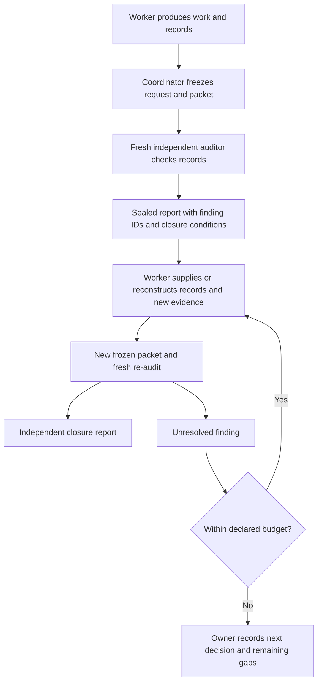

# Project Audit: Independent Record Assessment

Independent record assessment is the assurance loop within [VP's full project quality management method](how-vp-works.md). It supports accountable management while the worker retains technical execution and record keeping.

**Audit kind:** `project`. “Independent record audit” is an alias. Code Audit
has kind `code` and a separate scope. Ambiguous requests require the owner
to select the kind through [Audit Routing](../playbooks/audit-routing.md)
before any audit begins.

An AI immersed in implementation can explain away gaps or begin solving the
problem it was meant to assess. VP therefore separates the working AI from
the record auditor by context, responsibility and write authority.

The [standard §11](../standards/project-records.md) defines the contract; the
[playbook](../playbooks/record-audit.md) gives the procedure. The
[design record](project-records-design.md) preserves its derivation from
Medic and Pythia in NBS, including limits of evidence searches and observer
independence. Their team runtime and communication tools are not required.

## Responsibilities

| Role | Question it answers | Output |
|------|---------------------|--------|
| Working AI | What work and evidence should we produce under the authorised plan? | Technical work, durable records and finding responses |
| Independent record auditor | Does this packet support the recorded history, choices and current justification? | Scoped findings, evidence requirements, verdict and closure review |
| Owner/delegated coordinator | What scope, authority, gates and next task apply? | Audit requests, packets, routing and exception decisions |

The auditor can notice that a test does not support the claim attached to it.
It returns the unsupported claim and evidence requirement. Designing and
running the investigation, repairing the instrument or choosing the mechanism
remain working tasks. Reading a file to verify coverage does not turn the
record audit into a code-quality review.

## A Directory Handoff Loop

The owner may be human or AI. A human owner with a working AI and AI auditor
is the default current arrangement; an AI supervisor-like owner, working AI
and independent auditor is also supported. The charter records the owner's
mandate, limits, duration and escalation rather than assuming human identity.
The owner keeps goals and management decisions; the worker maintains the VP
records and current views. The auditor is independent of the authors it
assesses, including an AI owner. A replacement owner inherits recorded open
work and gates; replacement does not erase findings or renew evidence.

For each A, `request.md` identifies inputs, scope, role and budget;
`record.md` is the assessor's report. Packet metadata has a manifest under
`artefacts/<A-ID>/input/`: fixed commit, bounded scope and verified replica/external-evidence locators only, with no source copy or earlier packet contents. Findings have IDs such as `A-000001/F-001`.
The working AI answers using a V event of kind `audit-response`. A successor
A report closes the finding against a new snapshot. State and ledger provide
the current view while all original reports remain readable.

This can run with two separate AI sessions and file handoff. The coordinator
may be the owner or a working AI with delegated authority. It cannot claim
independence by giving itself another role name within the same context.

## What “Regenerate” Means

Regeneration can recover a missing explanation from preserved evidence,
repair a broken reference or produce a newly attributed successor document.
The record states when reconstruction occurred, what it used and what remains
unknown. Sealed records are preserved.

Regeneration cannot recreate missing historical observations. If the test log
is gone, a new execution creates a new protocol/run history. If the old choice
is unknowable, a current retain/replace decision can justify present code while
leaving the old gap visible. This distinction prevents an apparently tidy
repair from manufacturing provenance.

## Independence Has Two Meanings

A fresh auditor context provides role independence. It does not make the
worker's authored records independently captured evidence of actual actions.
The packet therefore identifies evidence producer, custodian, capture method,
coverage and alteration authority. Existing terminal/CI/operator captures can
strengthen provenance when preserved, but no particular capture software is
required. Digests bind bytes to the packet; they do not authenticate history.

An incomplete search can miss a real action. Findings state what was searched
and what was not available. Unsupported or uncertain is a useful verdict;
fabricated is a stronger accusation requiring contradictory evidence.
The assessor must also issue an explicit report: silence can mean no review.

## Example: Missing Test Provenance

This history is illustrative, not an executed trial:

1. A-000001/F-001 observes that D-000014 cites “all tests passed”, but its
   cited R lacks executable identity and raw output. The auditor searched the
   designated packet; other session logs were not supplied. The finding is a
   mandatory provenance gap, without an accusation of fabrication.
2. Its closure condition asks for original run/build identity and retained
   evidence, or an explicit loss declaration plus current revalidation and
   dependent decision review. It does not prescribe a product fix.
3. The worker creates V-000008: original evidence is unavailable. New H/E,
   B/R and a successor D justify the current snapshot; the old run remains
   unknown. V links all new evidence and marks the response ready for re-audit.
4. A-000002 inspects the new frozen packet. It may close current-snapshot
   justification while keeping historical provenance nonconformant if that
   historical scope is still claimed. It does not change A-000001's verdict.
5. The coordinator updates STATE with both scoped outcomes. Only a separate
   owner decision can change the declared scope; no historical gap is erased.

If the original finding was wrong and evidence already existed in an omitted
packet file, the follow-up report corrects it with the exact evidence and
access limitation. The worker cannot self-certify closure in either case.

## Gates without Role Drift

The charter applies standard §1.1: A protocol/result gates, B acceptance, C declared samples/stages, D/E no automatic audit. Project conformance does not add per-edit audits to D/E. It defines applicable triggers, periodic review cadence,
time and round budgets, response ownership and escalation. Required gaps
block the affected conformance claim; advisory risks can receive recorded
acceptance. The auditor reports against these rules and grants no new
authority over the product.

Keep each invocation finite: read, assess, report, end. Worker repair and
follow-up assessment are separate tasks. This prevents the observer from
joining an implementation discussion and provides a durable place for every
gap, response, disagreement and correction.
