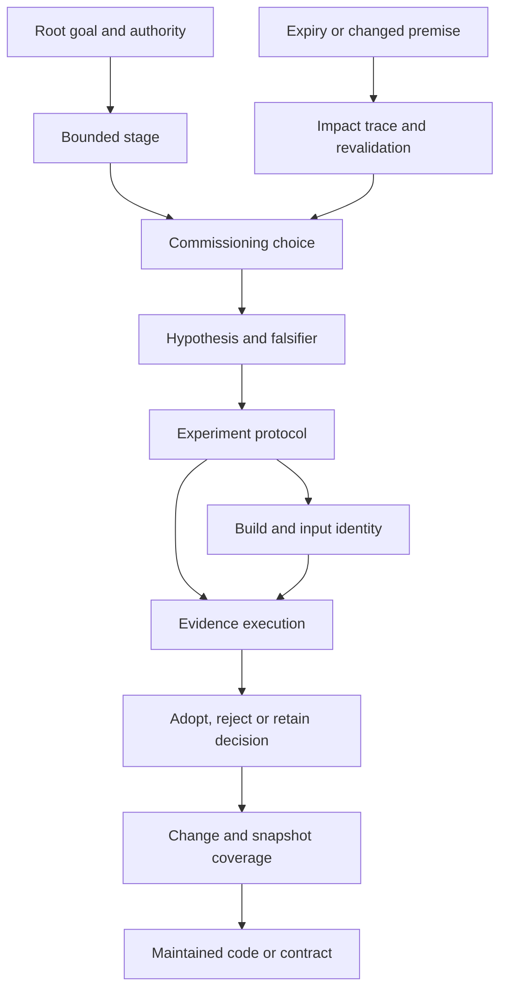

# Project Planning and Records

Project planning, control and traceable records are the management layer of [VP's full project quality management system](how-vp-works.md). They connect the owner mandate and quality criteria to bounded stages, choices, implementation evidence, independent gates and continuing review. The working AI keeps the records under owner oversight; an independent assessor checks their support.

A project can span many sessions, builds, contributors and machines. A status summary alone rarely explains what an earlier author knew, which alternatives failed, which exact binary produced a result or whether a premise remains current.

The [standard](../standards/project-records.md) supplies that implementation.
It is the explicit planning/record-conformance contract, version 1.0 proposed for adoption; the other VP procedures supply engineering, document and investigation quality checks.
Use the [playbook](../playbooks/project-records.md) for actions and the
[templates](../templates/project-records/README.md) for files.

The [independent audit loop](independent-record-audit.md) separates an assessor
from the working AI: a frozen packet leads to sourced findings, worker
responses and a fresh closure audit. The assessor stays within record
verification while the worker performs authorised technical investigation.

## The Record Chain

A root decision states the authorised goal. Stages organise bounded work.
Commissioning decisions explain what uncertainty or desired outcome led to
an experiment. Hypotheses state claims; protocols state how they will be
challenged; build and run records identify what actually executed. Adoption
decisions explain what the evidence justified. Change and coverage records
connect that choice to maintained code at a particular snapshot.

These arrows explain the workflow. Actual records carry timestamps and origin
links; a later adopting decision must not appear to have commissioned its own
earlier evidence. Builds are omitted where no compilation/artefact production
applies. A reader experiment records isolated inputs and responses instead.

## What Each Inspiration Contributes

| Inspiration | General requirement | Concrete implementation |
|-------------|---------------------|-------------------------|
| PRINCE2 | Work must remain valuable and controlled at decision boundaries | Root goal, stages, tolerances, exception/checkpoint decisions |
| Capability Maturity Model | A repeatable process needs observable compliance and improvement evidence | Required fields/actions, exact scope audits, recorded failures and process trials |
| Aircraft maintenance tracking | Identity, custody and valid inspection history travel with the maintained item | Snapshot coverage, build/input identities, manifests, finite horizons and triggered reinspection |
| Parallel GC observations | Repeated builds and defective measurement instruments can detach conclusions from actual inputs | Attempt identities, instrument testing, incoming dependency impact tracing |
| Honest observations | Contract authority, implementation agreement and reader comprehension require different evidence | Contract/document coverage, suitable protocols and separate owner/empirical review |

These are design influences, not claimed compliance with a management or
aviation certification. The [design register](project-records-design.md)
preserves observations, generalisation, alternatives, choices and falsifiers
for each material part of the standard.

## A Time Horizon Is Part of the Justification

A passed test describes an observation under identified conditions. It has
no automatic authority over a new binary, changed dependency, repaired test
harness, different workload or future user need. The standard therefore
separates the historical verdict from current validity.

Every relied-on claim and decision has an owner, finite review date and
earlier change triggers. The effective horizon is bounded by its dependencies.
When support expires or is contradicted, an event identifies affected
decisions and code. New evidence and a successor choice are needed before
current reliance resumes. Historical records remain readable.

The proposed default periods are policy starting points. They require owner
judgement and adoption evidence; this project has no basis to claim that
seven or thirty days is universally appropriate.

## Records Are More than a Clean Tree

One record root and stable IDs make navigation predictable. Manifests bind
raw files to their meaning and byte identity. Current views show the plan,
state, complete record ledger and code coverage. Sealed records preserve
earlier reasoning; later events explain corrections, movement and disposal.

Native evidence files can live beside Markdown manifests. The standard does
not require Honest, a database, Git or a custom CLI. A retained directory
bundle must contain enough records and inputs to be inspected independently.
Version control and optional automation can assist without defining meaning.

## Small Work and Legacy Work

Granularity follows material choices. A mechanical rename can share an
existing stage and use one change, one bounded verification batch and its
decision records. It needs no per-line reports or empty binary directories.
Its maintained units still need a lookup in coverage.

Existing projects start with read-only discovery and explicitly incomplete
history. Import records with original and reconstruction dates distinguished.
Where old rationale is gone, a new retain/replace decision can establish
current justification without inventing the past. Adoption is separate from
cleanup; disposal follows retention and consumer checks.

## How to Evaluate This Proposal

The [worked traces](project-records-examples.md) cover compiled and document
work; the [scenarios](project-records-scenarios.md) include interpreted code,
small edits, contract disagreements, invalid instruments, expiry and loss.
They specify falsifiers for the process. Illustrations are not empirical
evidence of independent AI conformance.

The strongest practical trial is a cold reader given only a retained project
bundle and a selected code unit: can they recover the root goal, rejected
options, actual test inputs, failures and current validity? Adoption must also
measure record-writing and audit cost. A process that preserves context but
regularly prevents useful progress needs revision.
